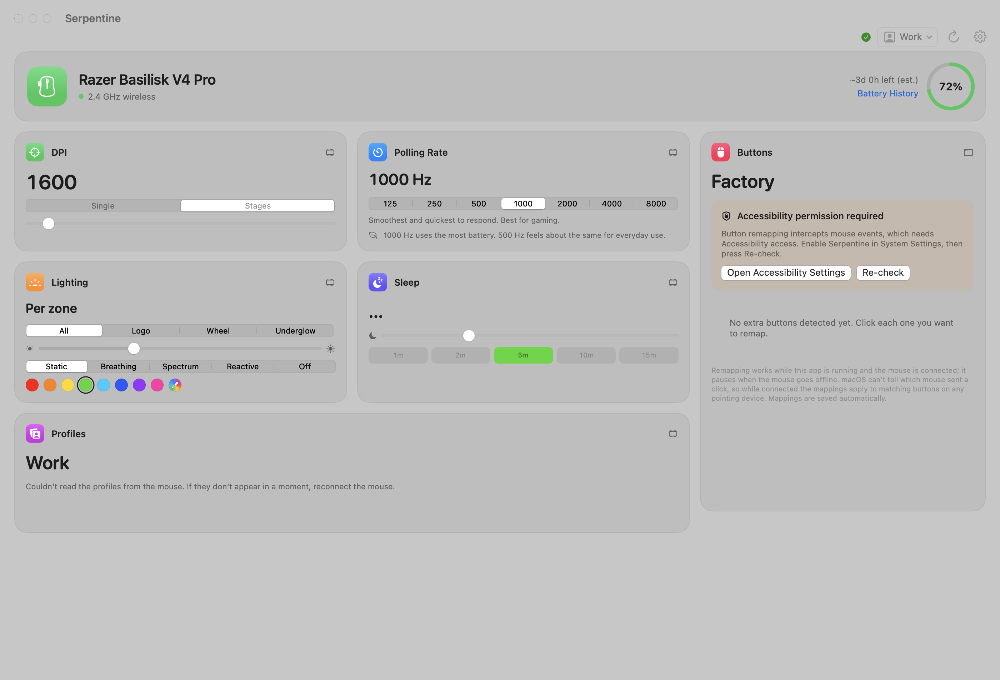
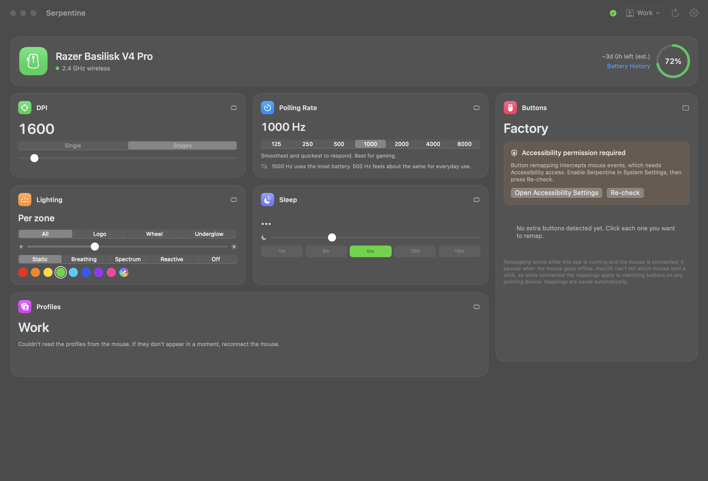

# Serpentine

Razer mouse control for macOS. Serpentine's aim is to put every setting in the mouse's own
memory, so the mouse behaves the same with the app closed, on any link and on any computer:
open it, set the mouse up, quit. What only software can do (the "driver mode" actions) works
while it runs, and it can keep running in the background, as a small menu bar item, for them.

A native Mac app with one window: a dashboard with the mouse and its battery on top and a tile
for each of its settings, on the glass. Razer does ship a Synapse for Mac now,
but its [supported-device list](https://mysupport.razer.com/app/answers/detail/a_id/14809/~/razer-synapse-for-mac-supported-and-compatible-devices)
is short and doesn't include the Cobra HyperSpeed or Atheris — this fills that gap. It talks
to the mouse directly over USB HID (no kernel extension, no driver install), using a protocol
ported from [OpenRazer](https://github.com/openrazer/openrazer).

Works best with the **Razer Cobra HyperSpeed** and the **Razer Atheris**, the two devices this
has actually been tested on. It detects any Razer mouse by name and should work with other
Razer mice that use the same HID protocol family, but those are untested, so treat support as
"likely to work, not verified" until someone confirms it on real hardware.

> Unofficial. Not affiliated with, authorized by, or endorsed by Razer Inc. See [NOTICE.md](NOTICE.md).
>
> Started as a fork of [MacRazer by SorcRR](https://github.com/SorcRR/MacRazer). It sends nothing
> anywhere: no usage stats, no update checks, no report uploads. See [Privacy](#privacy).
> 





## Features

- **A dashboard for the mouse**: a tile for each setting it has (DPI, polling rate, lighting,
  sleep, low battery, scroll wheel, profiles), each marked with where it lives, and the button
  remaps in a column beside them. It rearranges to the window's width. The battery history
  opens from the mouse's tile; Serpentine's settings are behind the cog.
- **Battery**, charging status, and a learned time-until-empty estimate. History and the
  estimate are kept per physical device (by serial number).
- **Battery usage**: the current discharge curve, the discharge rate, time since the last full
  charge, and a trend chart of past charge cycles with their average length.
- **DPI** with a slider (capped at each model's real maximum), the mouse's own preset stages
  read from the device, and a recallable custom value (per device).
- **Polling rate**: 125 / 500 / 1000 Hz.
- **RGB lighting**: static colour via an inline hue/saturation wheel, plus spectrum, wave, off,
  and a brightness slider.
- **Button remapping** for the side Back/Forward buttons (software, via a CGEvent tap):
  keyboard shortcuts (presets or a custom recorder), mouse clicks, and media keys. Saved per
  device.
- **Any Razer mouse is detected and named.** Controls a model lacks are hidden automatically
  (no lighting on the Atheris, no battery UI on wired-only mice).
- Settings are written to the mouse's **onboard memory** where supported, so they persist when
  the app is not running.
- **Background mode** (Settings): closing the window leaves a small menu bar item (the mouse's
  status, Open, Quit), so remaps
  the mouse can't store, low-battery alerts and battery history keep working. Off by default;
  Serpentine asks once when you set up something that needs it. It can then **start at login**,
  in the menu bar with no window.
Settings persist across app restarts and reconnects, and the window updates on its own when
the mouse connects, disconnects, or sleeps.

## Supported mice

"Verified" below means someone ran the CLI probes against the mouse and posted the output, not that the protocol tables say it should work. Where nobody has, the row
says so.

| Mouse | Verified on hardware | By |
|---|---|---|
| Razer Cobra HyperSpeed (wired + wireless) | Everything, continuously — the development mouse | maintainer |
| Razer Atheris | Battery, DPI, polling | maintainer |
| Razer Basilisk V3 X HyperSpeed | Battery, DPI, DPI stages, polling, lighting, brightness | [@joelday](https://github.com/joelday) |
| Razer Basilisk V4 Pro (wired, wireless + Bluetooth) | Battery, DPI, DPI stages, polling up to 8000 Hz, lighting per zone, brightness, sleep timer, low-battery level, wheel mode, Smart-Reel and its sensitivity, scroll acceleration, onboard profiles and button remaps. Over Bluetooth everything but polling and the wheel settings | contributor |
| Razer Viper Ultimate (Wireless) | Battery, DPI, polling, brightness | [@raphaelchenouard](https://github.com/raphaelchenouard) |
| Razer Orochi 2013 | DPI only | [@raphaelchenouard](https://github.com/raphaelchenouard) |
| Razer Basilisk V3 | Nothing; reported working by a user | — |
| Razer Cobra, Cobra Pro (wired + wireless) | Nothing; same protocol family, values from OpenRazer | — |
| Razer Basilisk X HyperSpeed | Nothing; values from OpenRazer | — |
| Razer Viper Ultimate (Wired) | Nothing; its wireless sibling is verified | — |
| Any other Razer mouse | Nothing; detected and named, controls attempted | — |

An unverified mouse is not a broken one. Detection and naming work for any Razer mouse, and
the controls are attempted with values taken from OpenRazer's tables — they usually work. The
column is about who has actually seen it happen.

**Have a mouse that isn't verified?** Run the [command-line probes](#command-line-diagnostics)
against it and open an [issue](../../issues) with the output.

Adding a model is a small change to a registry plus on-hardware verification. See
[CONTRIBUTING.md](CONTRIBUTING.md).

### Buttons Serpentine cannot see

Remapping works by watching macOS mouse events, so it can only reach buttons the mouse
actually reports to the Mac. Some buttons are handled *inside* the mouse and never send
anything — no app can detect those, Serpentine included.

The clearest example is the **Basilisk's multi-function trigger** (the third side button),
which ships assigned to **Razer Hypershift**. Hypershift is a modifier: held down, it
switches every other button to a second onboard layer. The firmware resolves that layer
itself, so pressing the trigger alone puts no report on the wire at all — verified by
watching every HID interface the mouse exposes while it was pressed.

To make it remappable, reassign it from Hypershift to a normal key or mouse button in
Razer Synapse (Windows only — Razer dropped macOS support). The assignment is stored in the
mouse's onboard memory, so it persists on the Mac afterwards and Serpentine will then see the
button like any other.

The exception is a mouse whose button table Serpentine knows, today the **Basilisk V4 Pro**.
There Serpentine writes each remap into the mouse's onboard memory itself, the way Synapse
does, and the remaps keep working with Serpentine closed, on any link and on other computers.
The side trigger is the HyperShift key until you remap it (any other button can take that
job), and the HyperShift layer is saved in the mouse too. The table was learned from the mouse's own replies, not from Synapse.

### Known limitation: two identical mice without a hardware serial

Per-device settings (custom DPI, button remaps, battery history) are keyed by the mouse's own
serial number when it reports one, otherwise by its USB product ID. If you own **two mice of
the exact same model and that model doesn't expose a serial**, both fall back to the same
PID-based key and will share one settings/history file: there's no other stable identifier to
tell them apart. This doesn't affect mixed setups (different models, or models that do report
a serial).

## Requirements

macOS 14 or later, on Apple Silicon or Intel.

**Connect over the 2.4 GHz dongle or a USB-C cable.** That's where Razer exposes its full
control protocol. The **Cobra HyperSpeed also works over Bluetooth**: battery, DPI stages,
brightness and a static lighting colour. Polling rate, other lighting effects, custom DPI
values and profiles still need the dongle or a cable. Serpentine asks for Bluetooth access the
first time it finds the mouse there.

Other models are a plain pointer over Bluetooth, so Serpentine can't read or change anything.
If your mouse has a mode switch, set it to 2.4 GHz. Serpentine tells you when it sees your
mouse on Bluetooth.

## Install

Download `Serpentine.dmg` from the [latest release](../../releases/latest), open it, and drag
**Serpentine** into Applications. Serpentine doesn't check for updates: new versions are on the Releases page.

This build is unsigned (no paid Apple Developer ID), so on first launch Gatekeeper will say
the app "cannot be opened because it is from an unidentified developer" or "is damaged and
can't be opened". Both are the standard unsigned-app warning, not an actual problem. To open
it anyway, do **one** of:

- Right-click (or Control-click) **Serpentine.app** in Finder, choose **Open**, then confirm
  **Open** in the dialog. (Only needed once.)
- Or, in System Settings > Privacy & Security, scroll to the bottom and click **Open Anyway**
  next to the Serpentine warning.
- Or, from Terminal: `xattr -cr /Applications/Serpentine.app`, then open it normally.

After that it launches like any other app. It will then ask for **Input Monitoring**
permission (and **Accessibility** if you use button remapping); see [Permissions](#permissions)
below.

## Build and run

To build from source: Xcode 16 / Swift 6.1.

```sh
# Run the app directly (easiest while developing; uses your Terminal's permissions):
swift run Serpentine

# Or build a standalone .app:
./Scripts/setup-signing.sh      # one-time: a stable self-signed identity (see Permissions)
./Scripts/build-app.sh          # produces "Serpentine.app"
open "Serpentine.app"
```

## Permissions

- **Input Monitoring** is required to send and receive HID reports to the mouse. The app
  requests it on launch; grant it in System Settings > Privacy & Security > Input Monitoring.
- **Accessibility** is required only for button remapping (the event tap). The remap screen
  has a button to open the right settings pane.

macOS binds a permission grant to the app's code signature. An ad-hoc build gets a new
signature on every rebuild, which resets the grant, so either run `Scripts/setup-signing.sh`
once (it creates a stable self-signed identity that `build-app.sh` then uses) or develop with
`swift run Serpentine`, which inherits your Terminal's grants.

If a build seems to stop dead at the codesigning step, it hasn't crashed: macOS is showing a
keychain prompt for the signing key (the build script says so once it has been waiting a few
seconds). Click **Always Allow** (not Allow), then run `Scripts/setup-signing.sh --repair`
once to grant codesign standing access so nothing prompts again.

## Command-line diagnostics

A separate command-line tool, `serpentine-cli`, runs probes against the mouse over USB (handy
for verifying a new mouse). Run these from a terminal:

```sh
swift run serpentine-cli info                 # list the mouse's HID interfaces
swift run serpentine-cli battery              # read battery %
swift run serpentine-cli dpi [x] [y]          # read or set DPI
swift run serpentine-cli poll [125|500|1000]  # read or set polling rate
swift run serpentine-cli rgb static ff0000    # static colour (or: spectrum | wave | off)
swift run serpentine-cli brightness [0-100]   # read or set LED brightness
```

## How it works

The mouse speaks Razer's HID protocol. We did not reverse-engineer it: the command bytes were
ported from OpenRazer's Linux driver and reimplemented in Swift over Apple's IOKit HID
Manager. No kernel extension is needed because Razer mice respond to standard USB HID feature
reports that any userspace process can send.

Full details, including the protocol, the per-device hardware quirks, and a file-by-file map,
are in [docs/DOCUMENTATION.md](docs/DOCUMENTATION.md). The complete feature history is in
[CHANGELOG.md](CHANGELOG.md).

## Contributing

Pull requests are welcome, especially **device profiles** so this works on more Razer mice.
See [CONTRIBUTING.md](CONTRIBUTING.md).

## License

GPL-2.0-or-later, see [LICENSE](LICENSE). The project is GPL because its HID protocol is
derived from OpenRazer. Full attribution and the trademark notice are in [NOTICE.md](NOTICE.md).

## Privacy

Serpentine makes no network requests of its own. It talks to your mouse over USB HID and
Bluetooth, and keeps its settings and battery history on your Mac. The links in About and in
the Help menu open in your browser when you click them, and nothing else leaves the app.

## Credits

Forked from [MacRazer](https://github.com/SorcRR/MacRazer) by SorcRR, whose work this builds
on. The mouse protocol is ported from [OpenRazer](https://github.com/openrazer/openrazer); see
[NOTICE.md](NOTICE.md).
